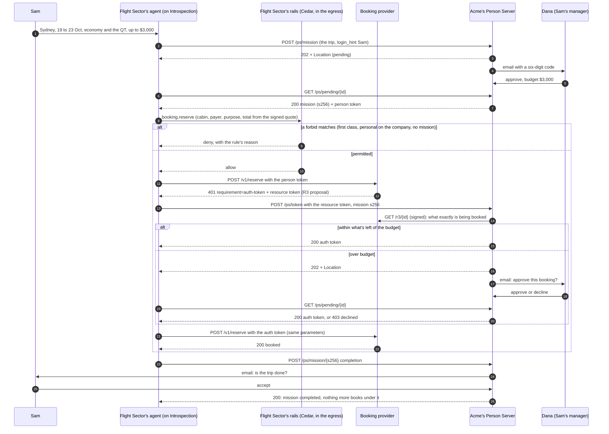

# How Flight Sector works

The detail behind the [README](./README.md): the parties, the flow, and how to configure it without the seed scripts.

## The parties

None of this is decided by the model, and the agent never holds a credential. It runs on [AAuth](https://github.com/dickhardt/AAuth) at -11, three-party, with a mission:

- the **Agent Provider** (the platform's control plane) mints an agent token for each session, binding the session's Ed25519 key;
- the platform's **egress** signs each of the agent's requests (RFC 9421) and presents the best token it holds;
- the traveller's **Person Server** (Acme's) approves the trip as a **mission** and issues person tokens under it;
- the **resource** (Flight Sector's booking provider) answers `401` with a resource token naming one booking's R3 proposal;
- egress takes the resource token to Acme, which answers `200` with an auth token within the trip's budget, `202` while it asks the manager, or `403`.

This example is the **Flight Sector side and the Acme side** of the demo, and the explainer. The platform side (Agent Provider, egress signing, missions, waiting on a `202`) is Introspection's.

- **Booking provider** (`https://booking.flightsector.localhost`) is a native three-party AAuth resource on [`@aauth/resource`](https://www.npmjs.com/package/@aauth/resource). Search is open and every offer carries a quote it signs. A reservation presenting an agent token gets `401 requirement=person-token`; one presenting a person token gets `401 requirement=auth-token` and a resource token for an R3 proposal only the person's Person Server can read; one presenting an auth token for that proposal is booked.
- **Acme's Person Server** is Acme's system, not Flight Sector's, and it runs one of two ways (`PERSON_SERVER`):
  - `hosted`: Introspection's hosted Person Server runs the protocol, the missions and their budgets, with Acme as its own tenant. Acme keeps the human side: its approval app (`lib/acme/hosted.ts`) lists what is waiting at `/v1/aauth/approvals` with its project's key, emails the approver a code, and records the answer.
  - `acme`: Acme runs its own (`https://ps.acme.localhost`, `lib/acme/person-server.ts`), as a Business that brings its own Person Server would.

  Either way the trip's manager approves it, budget and all, by a six-digit emailed code (page at `/approve/{id}`). Within the trip, an auth token is issued for each booking whose price (the resource token's `budget`) fits what is left, and anything over goes back to the manager. Nothing books outside a mission.

- **The walkthrough** (`http://localhost:3400/walkthrough`) covers every step of the default trip, beside the code behind it. `WALKTHROUGH.md` is the same thing as a document.

The agent itself is the public [travel-agent recipe](https://github.com/introspection-recipes/recipe-travel-agent). The walkthrough reads it from GitHub on its main branch (`flow/recipe.mjs`); while that repository is private, set `GITHUB_TOKEN` for the page to show its code.

## The flow

Sam's trip is "Flights and a hotel for Sam, 19 to 23 October, up to $3,000."

| Sam asks for                      | What happens                                                                                    |
| --------------------------------- | ----------------------------------------------------------------------------------------------- |
| The trip                          | `202`: Acme emails Dana, Sam's manager, a code. Dana approves the mission on Acme's page        |
| QF74 economy, SFO to SYD ($1,650) | `200`: within the trip's budget, so Acme issues an auth token and it's booked with no one asked |
| QT Sydney, 4 nights ($1,680)      | `202`: $1,350 is left, so Acme asks Dana again. Dana declines, and the agent asks Sam           |
| "I'm easy"                        | the agent books a cheaper hotel within the $1,350 left, with no one asked                       |
| A booking with no trip            | `403` from Acme, and from the recipe's `missionless-booking` rule before that                   |
| "That's everything"               | the agent proposes the mission complete; Sam accepts, and nothing more books under it           |

One booking, end to end. The agent is the travel-agent recipe running on Introspection; every arrow from it is a request Introspection's egress signs with the session's key (RFC 9421), after Flight Sector's rails allow it.



| Token          | What it says                                                                |
| -------------- | --------------------------------------------------------------------------- |
| agent token    | who the agent is: the Agent Provider binds the session's key                |
| mission        | the trip the manager approved, and its budget, by hash (`mission_s256`)     |
| person token   | the person the agent acts for, at one resource, under the mission           |
| resource token | the booking provider's ask: one reservation's R3 proposal, readable by Acme |
| auth token     | Acme's grant for exactly that reservation; the provider checks the retry    |

## Configuring it on Introspection

`pnpm dev` runs these the first time, against whichever stack `introspection login` chose. `BOOKING` and `MOCK` are the booking provider's and the Browserbase mock's public URLs.

```bash
# The agent: a hosted repository seeded from the public recipe, and its runtime
introspection repositories add travel-agent --provider introspection \
  --template https://github.com/introspection-recipes/recipe-travel-agent.git
git clone "$(introspection repositories list -o json --query "[?slug=='travel-agent'].url | [0]")" travel-agent
(cd travel-agent && introspection runtimes create --yes)

# Flight search: this app's mock (or https://mcp.browserbase.com/mcp with your key)
printf mock-browserbase-key | introspection bindings credentials create -r travel-agent --name BROWSERBASE_API_KEY --from-stdin
introspection bindings mcp connect -r travel-agent --mcp-server-id browserbase \
  --endpoint-url "$MOCK/mcp" --header 'Authorization=Bearer ${BROWSERBASE_API_KEY}'

# The application whose client id is the agent's AAuth identity
introspection applications create --type service-account --name "Flight Sector agent"

# The booking provider as an AAuth connector, with the stack-specific fields as flags
introspection connectors create @introspection/booking.json \
  --api-host "${BOOKING#https://}" \
  --person-server-url "$PERSON_SERVER" --application-id "$APPLICATION_ID" \
  --metadata "{\"aauth_resource\": \"$BOOKING\", \"aauth_tenant\": \"$ORG_ID:$PROJECT_ID\"}"

# Where the recipe calls the booking provider
printf '%s' "$BOOKING" | introspection bindings variables create -r travel-agent --name BOOKING_API_URL --from-stdin

# Sam, a customer member, with the attributes the rails read
introspection members create @introspection/sam.json

# The demo page's and Acme's key
introspection api-keys create --name "Flight Sector demo" --secret-file ./key
```

`PERSON_SERVER` is the hosted Person Server's issuer, from the data plane's `/.well-known/aauth-person.json`, or Acme's own URL with `PERSON_SERVER=acme`. The Agent Provider (`TRUSTED_AGENT_PROVIDERS`) is the issuer of the control plane's `/.well-known/aauth-agent.json`. The recipe calls the booking provider at its real host, `BOOKING_API_URL`; the connector's `api_hosts` names that host, which is how the egress knows to sign for it. `aauth_resource` is the identifier the egress signs for, and `aauth_tenant` the hosted Person Server's tenant: your project, standing in for Acme. `booking.json` names no host of its own, since the tunnel's host changes from run to run.

The connector's `policy_entities` and Sam's `policy_attributes` are what the recipe's `policies/` read before anything is signed, with the session's approved mission as `context.mission`. Their shapes are the recipe's `policies/schema.cedarschema`: Sam is a `Person` with a `level` and a `company`, and each `Company` has the least seniority that may fly business.

## The e2e script

`pnpm e2e` plays the agent with [`@aauth/agent`](https://www.npmjs.com/package/@aauth/agent), as the egress would, from a test Agent Provider of its own. It gives the booking provider, Acme's Person Server and the test provider each a quick tunnel, starts the app trusting that provider, approves each email from the app's log, and stops it all at the end. With `PERSON_SERVER=hosted` and `E2E_SERVER_LOG` pointing at a running app's log, it plays the same agent against Introspection's hosted Person Server instead.

## Settings

`pnpm dev` writes the URLs from its tunnels and the stack you are logged in to into `.env.local`; the defaults below only apply to the app run on its own. Put overrides in `.env.local`; `.env.example` documents them all.

| Variable                                                   | Default                                      | What it is                                                  |
| ---------------------------------------------------------- | -------------------------------------------- | ----------------------------------------------------------- |
| `APP_URL`                                                  | `http://localhost:3400`                      | the app's origin                                            |
| `BOOKING_ISSUER`                                           | `https://booking.flightsector.localhost`     | the booking provider's AAuth identifier                     |
| `BROWSERBASE_MCP_URL`                                      | `https://browserbase.flightsector.localhost` | the mock Browserbase MCP's host                             |
| `BOOKING_PERSON_SERVERS`                                   | `ACME_PERSON_SERVER_URL`                     | Person Servers whose people the provider serves             |
| `ACME_PERSON_SERVER_URL`                                   | `https://ps.acme.localhost`                  | Acme's Person Server identifier                             |
| `ACME_TRUSTED_RESOURCES`                                   | `BOOKING_ISSUER`                             | resources whose resource tokens Acme accepts                |
| `TRUSTED_AGENT_PROVIDERS`                                  | `https://cp.introspection.localhost`         | Agent Providers whose agents may act here (comma-separated) |
| `ACME_PS_SUBJECT_SECRET`                                   | random per process                           | derives each person's directed `sub` per audience           |
| `ACME_PS_SIGNING_KEY`, `BOOKING_SIGNING_KEY`               | generated per process                        | PKCS#8 Ed25519 PEMs for stable keys                         |
| `RESEND_API_KEY`, `ACME_MAIL_FROM`                         | unset: print to console                      | how Acme emails Dana                                        |
| `ACME_WORKSPACE_ID`, `ACME_SAM_USER_ID`, `ACME_DANA_EMAIL` | the emulator's seed                          | Sam and Dana on a real Slack workspace                      |

## How the explainer works

`flow/manifest.mjs` lists the steps. Each step names its sources:

- `example`: a file here, cut to a `#region`;
- `recipe`: a file from the recipe, fetched from GitHub at the pinned commit;
- `contract`: the shape of a platform message on the wire, from `flow/contracts/`.

The page reads the real files at request time, and `pnpm walkthrough` writes `WALKTHROUGH.md` from the same manifest, so the explanation can't drift from the code. Platform internals are never shown: platform steps appear only as their contracts.

After changing the recipe, run `pnpm walkthrough` to refresh `WALKTHROUGH.md`; the page reads it live.
