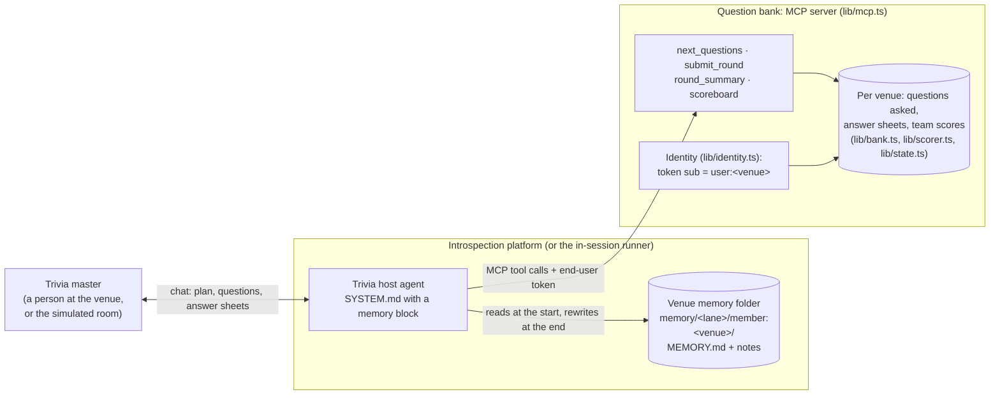
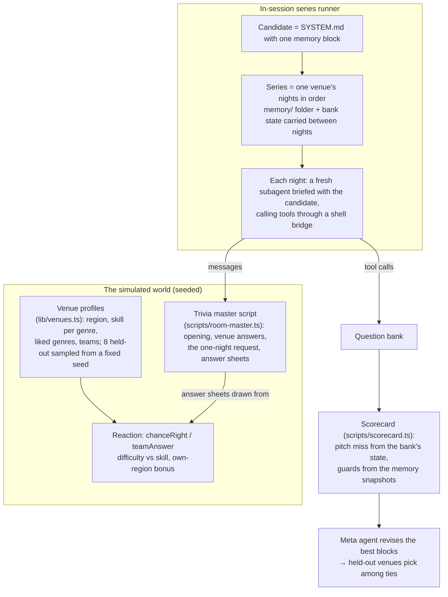

# How Trivia Night works

A trivia host (the agent) runs quiz nights at many venues and gets better at each one. Two stores hold what carries between nights, and they never overlap:

- **The question bank** holds facts: the questions, which ones each venue has heard, and how its teams answered. It is an MCP server, and it enforces its rules in code.
- **The host's memory** holds judgement: per venue, the few settings that change the next night's choices (region, liked genres, a level per genre). It is the agent's own folder for that venue, written by the agent under the rules in its memory block.

## The pieces



- **No tool takes a venue.** The platform runs each venue's conversations as one end user (`--subject <venue>`) and sends a signed token naming it; `lib/identity.ts` verifies it and the bank keys everything by that venue. With no platform, a development header stands in.
- **Never repeating a question is the bank's job.** `next_questions` only returns questions that venue hasn't heard; when a genre, region and level runs dry it widens the filter (region to global, then difficulty by one step) and says so, never repeating. The host's memory is not allowed to keep questions, so it cannot get this wrong.
- **Team names and scores live in the bank**, because scoring needs them. The memory rules forbid keeping them in the notes.

## A night

```mermaid
sequenceDiagram
  participant TM as Trivia master
  participant H as Host
  participant M as Venue memory
  participant B as Question bank
  H->>M: read MEMORY.md and the venue's notes
  H->>TM: the plan (genres, starting level, why)
  loop each round
    H->>B: next_questions(genre, region, difficulty)
    B-->>H: questions this venue hasn't heard
    H->>TM: the questions, read out to the room
    TM-->>H: every team's answers
    H->>B: submit_round(answers)
    B-->>H: scores and correct answers
    H->>B: round_summary
    B-->>H: share right, by genre and difficulty
    H->>TM: scores; next round's level (one step at most) and why
  end
  H->>M: rewrite the notes: only what changes next week's choices
```

The rules the owner set: adapt between rounds, never inside one; one level at a time; say the plan at the start; a request for tonight is never a lasting preference; never keep team names, scores or the questions asked.

## How it is tested and improved



- **Everything except the host is fixed and seeded**, so a comparison measures only the memory block. Two blocks that make the same calls get the same results to the question.
- **The supply is sized** (240 questions, or 2,102 with `TRIVIA_BANK=large`) so a venue's series never empties a cell; a bank that ran short decided an early result.
- **The scorecard reads the record, not the host's account of it:** pitch miss (points from 65% right, nights two onward), asked-for rounds, unfair questions, repeats, and whether the one-night request reached the notes.

With released tooling the same shape needs no hand-written harness: the bank and the trivia master are eval-simulate fakes in the Recipe's `fakes/`, and `introspection eval simulate call|state` carries their state across a series. The Operator's `improve-memory` step runs the whole loop; [WALKTHROUGH.md](./WALKTHROUGH.md) replays it from one prompt.
