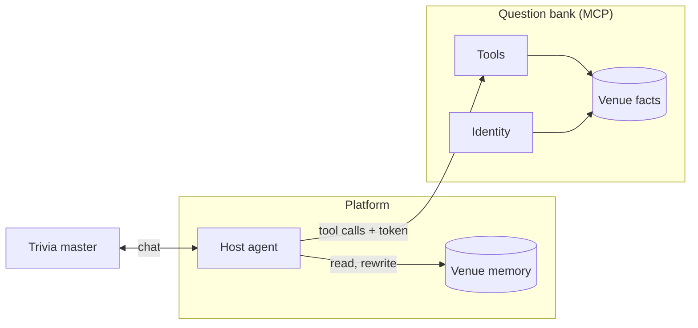
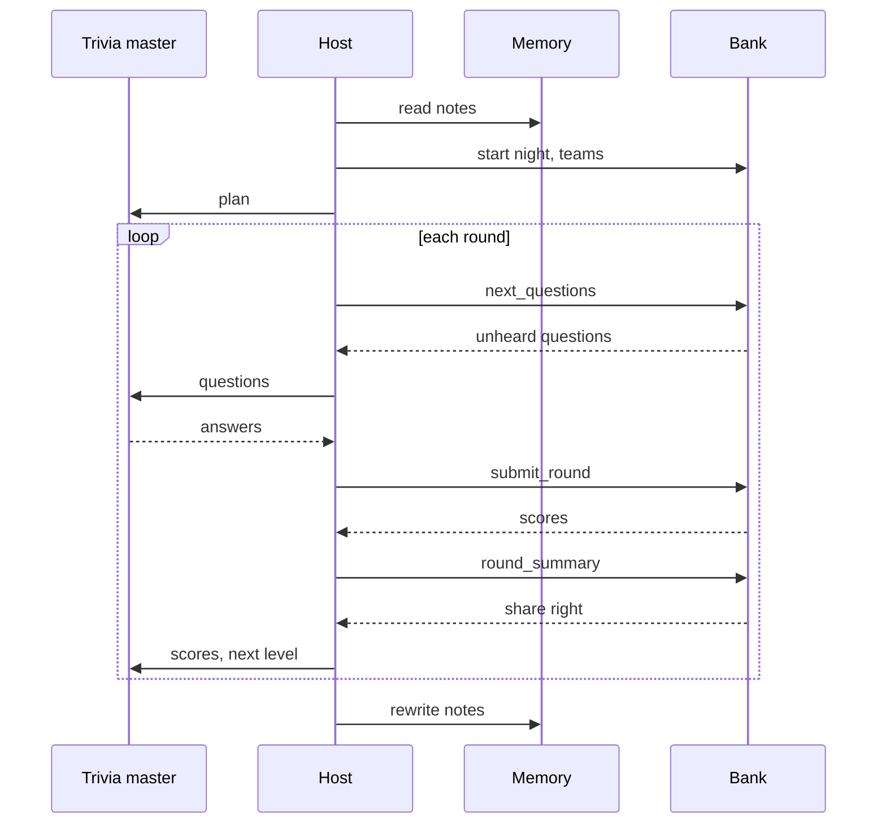
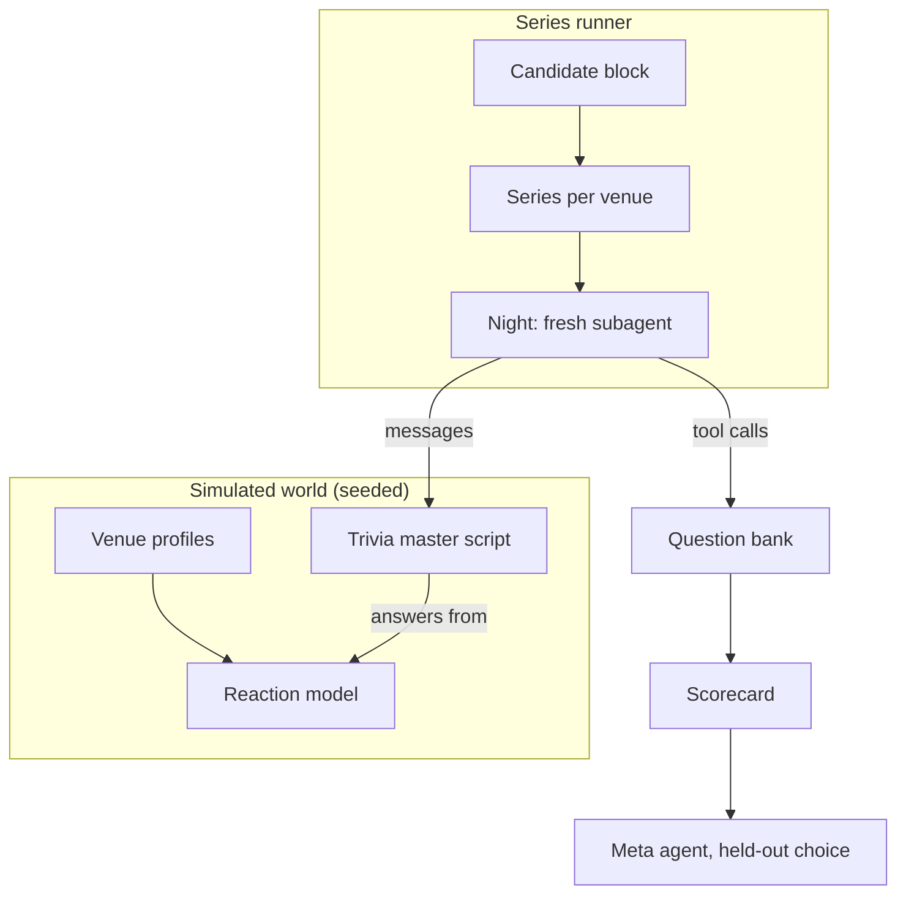

# How Trivia Night works

A trivia host (the agent) runs quiz nights at many venues and gets better at each one. At each venue a trivia master, a person at the bar, reads the host's questions out to the room and types in the teams' answers. The host never sees the room directly: everything it knows about a venue comes from the trivia master, the question bank, and its own notes from earlier nights.

Two stores carry anything from one night to the next, and they never overlap:

- **The question bank** holds facts: the questions, which ones each venue has heard, and how its teams answered. It is an MCP server (`scripts/bank-server.ts` serves it at `/mcp`), and it enforces its rules in code.
- **The host's memory** holds judgement: per venue, the few settings that change the next night's choices, such as its region, the genres the crowd likes, and a level that suits it in each genre. It is the agent's own folder for that venue, written by the agent under the rules in its memory block.

Keeping them apart is a design rule, not an accident: a fact the bank can enforce never depends on the agent remembering it, and the agent's memory stays small enough to rewrite every night.

## The pieces

What this shows: the three parties in a night and what each one holds. Boxes are components, cylinders are stores, and arrows are who talks to whom. The left group is the agent and its memory, which the Introspection platform runs (or, in testing, the in-session runner described below). The right group is the question bank this example serves. The trivia master sits between them in a chat with the host.

- **Host agent:** the Recipe's agent; its `SYSTEM.md` carries the memory block.
- **Venue memory:** one folder per venue, `memory/<lane>/member:<venue>/`, indexed by `MEMORY.md`.
- **Tools:** `start_night`, `register_teams`, `next_questions`, `submit_round`, `round_summary`, `scoreboard` (`lib/mcp.ts`).
- **Venue facts:** questions asked, answer sheets and team scores (`lib/bank.ts`, `lib/scorer.ts`, `lib/state.ts`).
- **Identity:** `lib/identity.ts` reads the venue from the token (`sub = user:<venue>`).

What to notice:

- **No tool takes a venue.** The platform runs each venue's conversations as one end user (`--subject <venue>`) and sends a signed token naming it. `lib/identity.ts` verifies the token, and the bank keys everything by that venue, so one venue can never read or change another's history. With no platform, a development header stands in for the token.
- **Never repeating a question is the bank's job.** `next_questions` returns only questions that venue hasn't heard (`lib/bank.ts`). When a genre, region and level runs dry, it widens the filter (region to global, then difficulty by one step) and says so, rather than repeating. The host's memory is not allowed to keep questions, so it cannot get this wrong.
- **Team names and scores live in the bank**, because scoring needs them (`lib/scorer.ts`). The memory rules forbid keeping them in the notes.
- **The memory folder is the platform's**, not the bank's: on a deployed agent it is `memory/<lane>/member:<venue>/`, and its index, `MEMORY.md`, is loaded at the start of every conversation with that venue.

## A night

What this shows: the order of messages in one night, read top to bottom. Each column is one party from the diagram above; a solid arrow is a request or a message, and a dashed arrow is the reply. The box marked "loop" repeats for every round, three or four times a night.

What to notice:

- **Memory is touched twice a night:** read before the plan, rewritten after the last round. Nothing in between writes to it, so a request made during the night ("a music round for a birthday table, just tonight") shapes tonight's rounds without ever reaching the notes.
- **Every adjustment happens between rounds**, using the bank's round summary: if the room got more than three in four right, the next round goes up one level; fewer than about one in two, down one. A round never changes level partway through.
- **The plan comes first**, so the trivia master knows why tonight looks the way it does, usually because of what the notes say worked last time.

These are the owner's rules: adapt between rounds, never inside one; one level at a time; say the plan at the start; a request for tonight is never a lasting preference; never keep team names, scores or the questions asked.

## How it is tested and improved

What this shows: how a memory block is measured and improved without real venues. The top group is a simulated world that stands in for the venues and their trivia masters. The middle group plays many nights through it, one fresh agent per night. The bottom row turns the record into scores and a better memory block. Arrows follow the data: tool calls and messages go into the world, and the bank's saved state comes out as scores.

- **Venue profiles** (`lib/venues.ts`): region, skill per genre, liked genres, teams; eight held-out venues sampled from a fixed seed.
- **Reaction model** (`chanceRight`, `teamAnswer`): harder questions and a weaker genre mean fewer right; the venue's own region is easier.
- **Trivia master script** (`scripts/room-master.ts`): the opening, answers about the venue, the one-night request, the answer sheets.
- **Candidate block:** `SYSTEM.md` with one memory block. **Series:** one venue's nights in order, memory and bank state carried between them. **Night:** a fresh subagent briefed with the candidate.
- **Scorecard** (`scripts/scorecard.ts`): pitch miss from the bank's state, guards from the memory snapshots. **Meta agent:** revises the best blocks; held-out venues choose among ties.

What to notice:

- **Everything except the host is fixed and seeded**, so a comparison measures only the memory block. The same seed and the same calls give the same outcomes to the question; a repeat uses a new seed, which changes the crowds and nothing else.
- **Each night is a fresh agent.** It knows the venue only through the memory folder the previous night left, exactly as a deployed agent would.
- **The supply is sized** (240 questions, or 2,102 with `TRIVIA_BANK=large`) so a venue's series never empties a genre, region and level. A bank that ran short decided an early result: the memory that rationed questions best looked best.
- **The scorecard reads the record, not the host's account of it:** pitch miss (how far each round's share right sat from 65%, on nights two and three), asked-for rounds, unfair questions, repeats, and whether the one-night request reached the notes.
- **The meta agent reads the worst nights' transcripts and notes** and rewrites the memory block; finalists that tie on the training venues are chosen on held-out venues the meta agent never saw.

With released tooling the same shape needs no hand-written harness: the bank and the trivia master become eval-simulate fakes in the Recipe's `fakes/`, and `introspection eval simulate call|state` carries their state across a series. The Operator's `improve-memory` step runs the whole loop, and [WALKTHROUGH.md](./WALKTHROUGH.md) replays it from one prompt.
